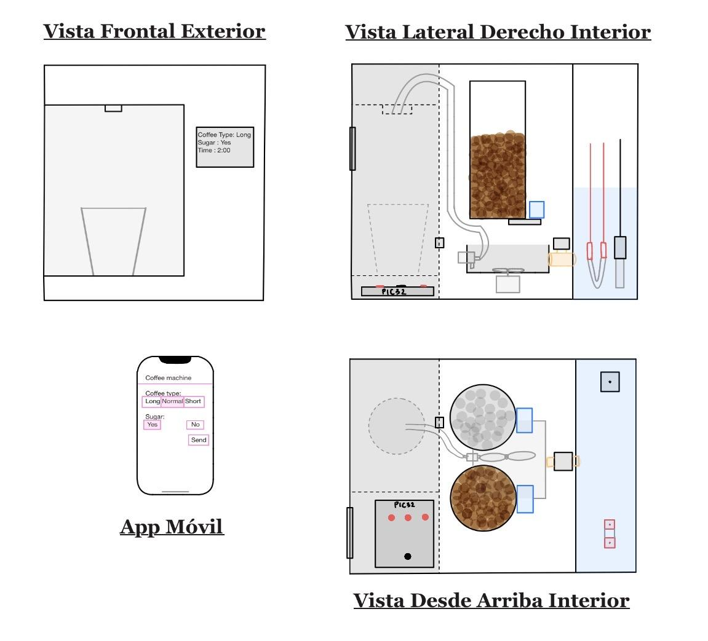
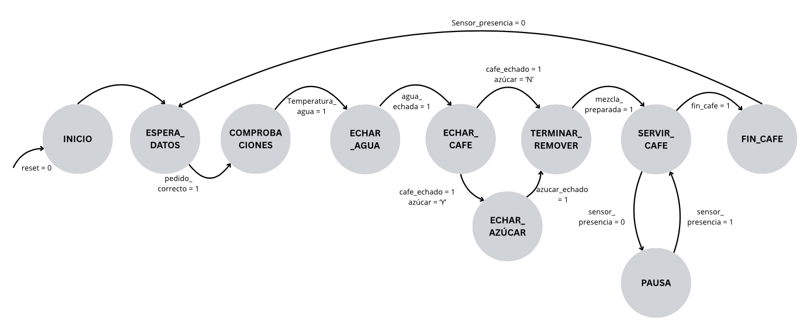
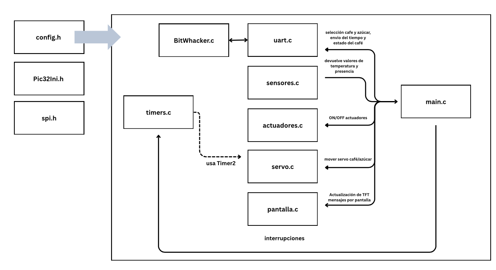

# Cafetera automatizada con PIC32

**Control de una cafetera mediante un microcontrolador, sensores, actuadores y una aplicación móvil.**

Proyecto de **Isabel Alonso Casas** y **Bibiana Dorado Mateos**, desarrollado para la asignatura de **Microprocesadores** en la **Universidad Pontificia Comillas — ICAI**.

El sistema permite elegir un café corto, normal o largo, con o sin azúcar, y coordina las etapas de calentamiento, dosificación, mezcla y servicio mediante una máquina de estados programada en C.

## Vídeo de demostración

### [Ver el vídeo de la cafetera](https://upcomillas-my.sharepoint.com/:v:/g/personal/202301114_alu_comillas_edu/IQCw-3xlDj8JQKc9DCW5or0uARFAcWHtTdljE3raWDFIOhw)

[Leer la memoria del proyecto](docs/informe-final.pdf) 

## Diseño de la cafetera

## Funcionalidades

- Selección de **café corto, normal o largo**, con o sin azúcar, desde la app.
- Recepción de pedidos mediante **Bluetooth Low Energy y UART**.
- Inicio alternativo desde el pulsador de la placa con un café normal con azúcar.
- Comprobación de temperatura mediante un **termistor NTC y el ADC** del microcontrolador.
- Control de electroválvula, calefactor, motor de mezcla y bomba mediante relés.
- Dosificación de café y azúcar mediante **dos servomotores controlados por PWM**.
- Presentación del estado del proceso en una **pantalla TFT** y mediante los LED de la placa.
- Detección del vaso con un sensor infrarrojo: pausa de la bomba cuando se retira durante el servicio y reanudación al volver a colocarlo.
- Espera a que se retire el café terminado antes de admitir un nuevo ciclo.

## Funcionamiento

1. **Pedido:** la aplicación envía la selección de café y azúcar; también puede utilizarse el pulsador de la placa.
2. **Comprobación y calentamiento:** el sistema espera a que el sensor alcance el umbral de temperatura previsto.
3. **Dosificación:** la electroválvula introduce agua y los servomotores dosifican el café y, si se solicita, el azúcar.
4. **Mezcla:** el motor permanece activo durante el tiempo programado.
5. **Servicio:** la bomba lleva la mezcla al vaso; si el vaso se retira, el sistema pasa al estado de pausa.
6. **Fin:** la pantalla indica que el café está listo y el sistema espera a que se retire el vaso para reiniciar el ciclo.

*Diagrama original de la memoria.*

## Organización del software

| Archivo o módulo | Función |
| --- | --- |
| `main.c` | Máquina de estados y coordinación del proceso |
| `config.c` / `config.h` | Asignación e inicialización de pines |
| `Pic32Ini.c` / `Pic32Ini.h` | Configuración del reloj del microcontrolador |
| `UART1.c` / `UART1.h` | Comunicación serie y recepción de órdenes |
| `BitWhacker.c` / `BitWhacker.h` | Interpretación de los comandos de café y azúcar |
| `sensores.c` / `sensores.h` | Lectura del sensor infrarrojo y del ADC de temperatura |
| `actuadores.c` / `actuadores.h` | Encendido y apagado de los actuadores mediante relés |
| `servo.c` / `servo.h` | Control de los dos servomotores |
| `timers.c` / `timers.h` | Base temporal para el PWM y los tiempos del proceso |
| `Pantalla.c` / `Pantalla.h` | Interfaces y mensajes de la pantalla TFT |
| `TftDriver/` | Controlador de la pantalla, fuentes, fichas técnicas y licencias originales |

Ver el esquema original de la arquitectura del software

## Aplicación y comunicación

La app se incluye en **`app/AppCafetera.aia`**, un archivo de proyecto editable de MIT App Inventor. Incluye la interfaz, los bloques de programación y la extensión Bluetooth Low Energy utilizada.

La aplicación permite buscar dispositivos, conectarse, seleccionar el tipo de café y el azúcar, enviar el pedido y consultar una consola de comunicación.

El firmware configura UART a **9600 baudios, 8 bits de datos, sin paridad y un bit de parada**. Las órdenes siguen el formato `tipo,azucar`, terminado en salto de línea (`\n`):

| Parte del comando | Valores |
| --- | --- |
| Tipo de café | `C` = corto · `N` = normal · `L` = largo |
| Azúcar | `Y` = con azúcar · `N` = sin azúcar |

Por ejemplo, `N,Y` solicita un café normal con azúcar y `C,N` un café corto sin azúcar. La app incluye un control **ENDL** para el final de línea. El programa responde por UART con mensajes como `Pedido recibido`.

## Autoras y créditos

**Isabel Alonso Casas · Bibiana Dorado Mateos · José Daniel Muñoz Frías (controlador)**  
Microprocesadores · Universidad Pontificia Comillas — ICAI

